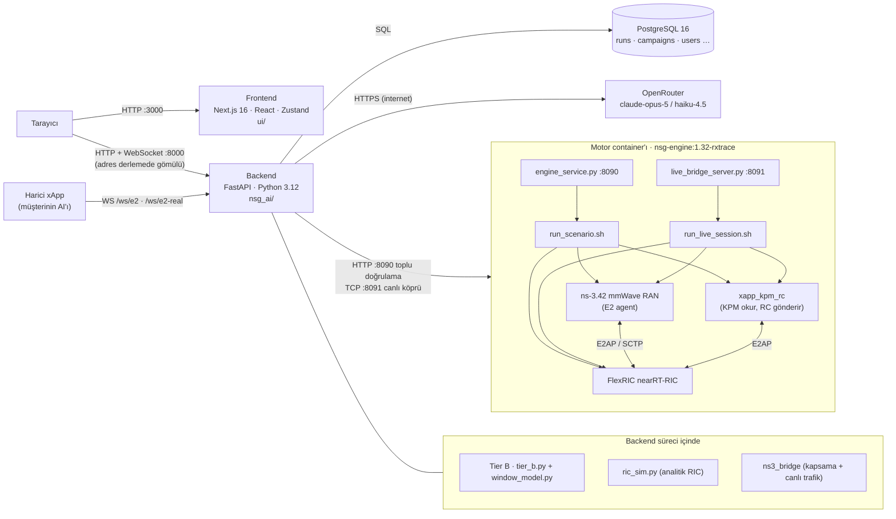
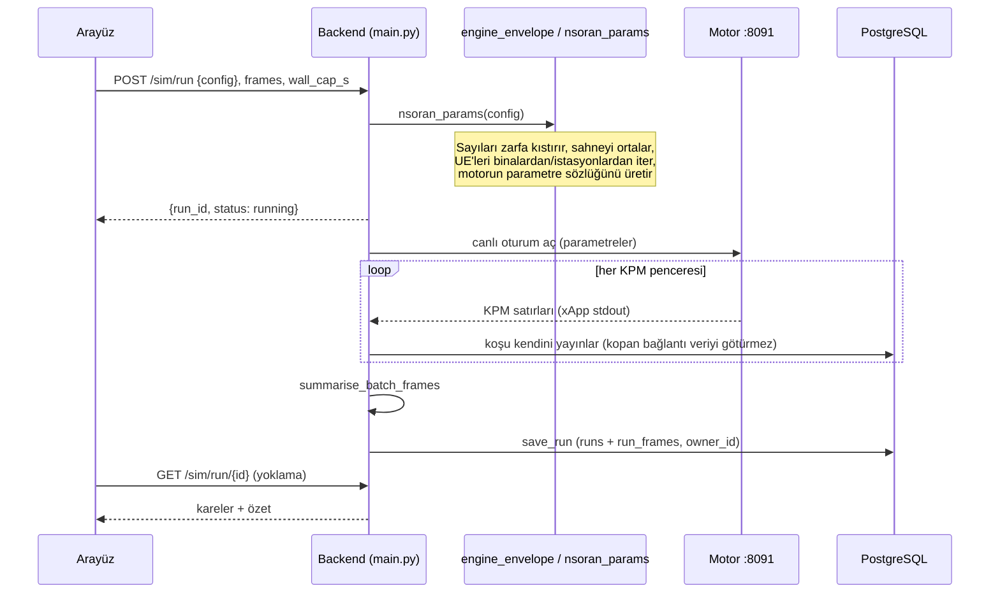
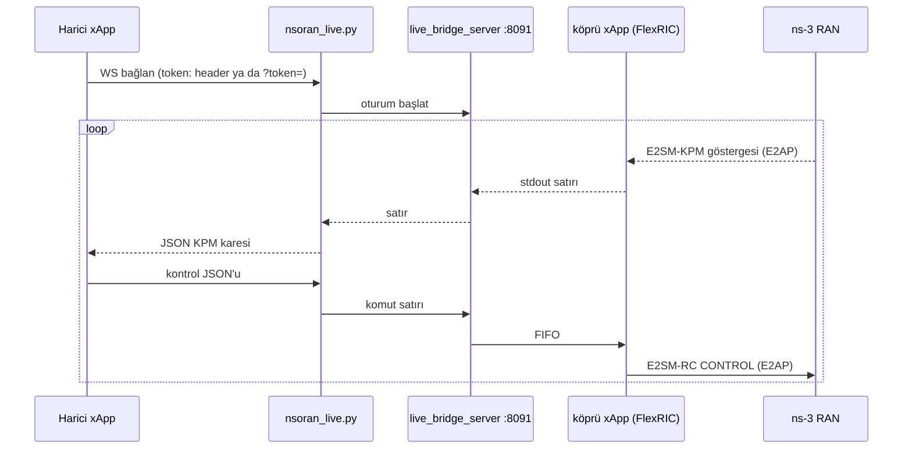

# 2. Mimari

## Bileşenler

**Dağıtımda** (bkz. [09](09-kurulum-ve-isletim.md)) dördü de tek makinede Docker
Compose ile koşar: `db`, `engine`, `backend`, `frontend`. Motor portları
**dışarıya yayınlanmaz**; yalnız backend, compose ağı üzerinden `engine:8090` /
`engine:8091` adresine ulaşır. Nedeni: motor API'sinin kendi kimlik doğrulaması
yok ve bir zamanlar içinden kabuk komutu çalıştırılabildiği kanıtlandı
(`tools/security_probe.py`).

> **İnternet notu.** LLM çağrıları dışarıya (openrouter.ai) gider. İnternetsiz bir
> makinede AI sohbet ve AI ile senaryo üretimi çalışmaz. Diğer her şey (kanvas,
> editör, koşular, kampanyalar, RIC testi) internet istemez. Backend, geçerli
> olmasa bile bir `OPENROUTER_API_KEY` tanımlı değilse **hiç açılmaz**, bkz.
> [10](10-bilinen-sinirlar.md).

## Motor yolları: hangi ekran neyi çağırır

| Ekran / istemci | Uç nokta | Nereye gider | Nasıl |
|---|---|---|---|
| Sohbet | `POST /ai/modify` | OpenRouter | Konfigürasyon LLM'i, şemaya uygun çıktı üretir; `ai_interactions` tablosuna kaydedilir |
| Visual / Analytics — kapsama | `POST /run-simulation` | süreç içi `ns3_bridge.rsrp_heatmap` | Analitik RSRP ızgarası |
| Analytics — canlı trafik | `WS /ws/live-traffic` | süreç içi `ns3_bridge.estimate_live_throughput` | Tik başına tahmin |
| RIC Test (analitik) | `WS /ws/e2` | süreç içi `ric_sim` | Paylaşılan oturum; harici xApp aynı oturuma katılır |
| RIC Test (gerçek motor) | `WS /ws/e2-real` | motor `:8091` | `nsoran_live.py` proxy'si; kontrol satırları gerçek E2SM-RC'ye dönüşür. Aynı anda tek oturum. |
| Koşu (batch) | `POST /sim/run` | motor `:8091` | "Batch" burada **headless** demektir: canlı köprü üzerinden akar, kareler kaydedilir |
| Compare | `POST /ric/validate-nsoran` | motor `:8090` | Bloklayan tek istek, tek toplu sonuç |
| Campaign (slow) | `POST /campaigns` `tier=slow` | motor havuzu `:8091` | Her koşu bir motor örneğinde; havuz eşzamanlılığı sınırlar |
| Campaign (fast) | `POST /campaigns` `tier=fast` | süreç içi Tier B | Motor, kilit, köprü yok |

## Akış 1 — Gerçek motorda bir koşu (`/sim/run`)

Koşu statüleri iki yerden gelir. Motorun toplu sonucu: `ok`, `truncated` (ns-3
yolda öldü, eldeki KPM gerçek), `crashed`, `no_data`, `partial`, `busy`;
`ended_by` alanı nedenini söyler. Backend'in koşu kaydında ayrıca görülenler
(2026-09 veritabanında sayıldı): `done` / `completed` (canlı yoldan biten),
`wall-capped` (duvar saati bütçesi doldu; bu yolda olağan bitiş budur),
`timeout`, `interrupted`, `engine-closed`, `error`. Koşu boş dönerse **ilk bakılacak yer** motor
container'ındaki `/tmp/scn0.log` dosyasıdır; son satırı ns-3'ün tam komut
satırıdır (bkz. [06](06-motor-slow-tier.md#günlükler)).

## Akış 2 — Müşterinin xApp'i gerçek motoru sürüyor (`/ws/e2-real`)

Müşteri tarafında FlexRIC SDK gerekmez; indirilebilir bağlayıcı şablonu
`GET /ric/xapp-connector-real` ile alınır. Analitik karşılığı (`/ws/e2`)
aynı sözleşmeyi konuşur ama standart E2AP değildir, kendi JSON'umuzdur.

## Akış 3 — Fast tier'ın sayıları gerçek E2AP üzerinden (araçla)

Tier B'nin gerçek RIC ile konuşabildiği **kanıtlandı**, ancak bu yol **ürün
arayüzüne bağlı değildir**; araçlarla çalıştırılır:

`nsg_ai/e2_feed.py` bir dosyaya satır başına `<ölçüm adı> <imsi> <değer>` yazar →
`engines/flexric/nsg_feed.c` bu dosyayı FlexRIC'in emülatör ajanı içinden okur →
nearRT-RIC → üretimdeki `xapp_kpm_rc`. Çalıştırma: `tools/tier_b_serve.py`,
`tools/e2_spike.sh`. Ayrıntı: [07](07-fast-tier.md#gerçek-e2ap-üzerinden).

## Tasarım kararları

| Karar | Neden |
|---|---|
| Motor **ayrı bir container / ayrı dağıtım**, ayrı Ubuntu 20.04 | ns-3 mmWave çatalı en temiz 20.04'te derleniyor; ana sistemi bozmasın |
| Motor kodu **yalnızca yeniden kurulan imajla** ürüne ulaşır | Derleme ağacında derlemek ürünü değiştirmez; kayma sessizdir (bkz. [06](06-motor-slow-tier.md#motor-kodu-üç-yerde-yaşar)) |
| **Zarf (envelope) tek doğruluk kaynağı** | Aynı sabitler hem backend kıstırmasını hem LLM talimatını besler; genişletmek tek satır |
| Tier B **motorun parametrelerinden** kurulur, konfigürasyondan değil | İki katman aynı geometriyi görür; fark model hatası olarak okunabilir |
| **Kullanıcı başına izolasyon** `owner_id` ile | Başkasının kaydı 403 değil **404** döner (var olduğunu doğrulamamak için) |
| Yerel JWT, bulut kimliği değil | On-prem müşteriyle çelişmesin. `auth.decode_token` ileride OIDC/Keycloak geçişinin tek dikiş yeri |
| Motor portları yayınlanmaz | Kimlik doğrulamasız ve bir zamanlar kabuk komutu çalıştırılabilen bir API |
| Kampanya hükmü (`campaign.py`) motorsuz birim test edilir | Yanlış olmaması gereken kısım, motor koşusu gerektirmeden sınanabilsin |
